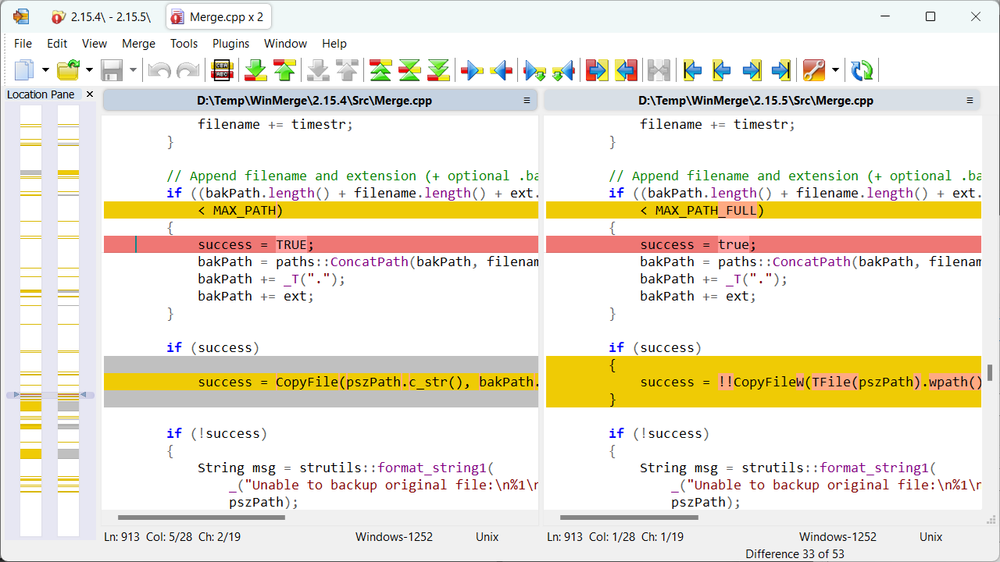
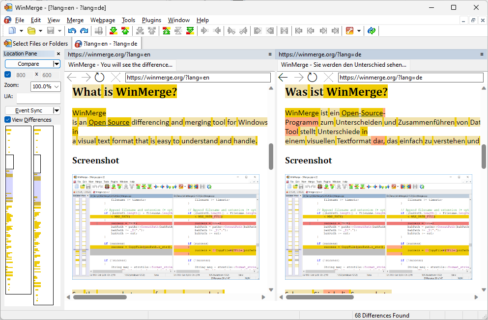
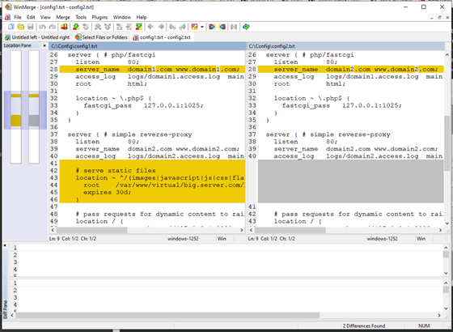

# WinMerge

WinMerge Software is a free visual compare and merge tool for Windows, published by Thingamahoochie Software. It opens two or three text files, folders, or images and marks the lines that changed, so you can copy only the parts you want to keep.

A session starts from Explorer or from the open dialog. You choose the left and right sides, scan the tree, and walk the rows that differ. The same window is used for a single file and for a whole directory.

## What Can WinMerge Do?

The compare window is built for reading changes.

- **File comparison.** Two or three text files sit in panes. Differences are marked by line, and a changed word inside a line can be marked on its own.
- **Folder comparison.** Directories and nested folders are scanned for files that are missing, identical, or modified.
- **Merging.** Copy one difference from the left, right, or middle pane and leave the rest of the file untouched.
- **Syntax colors.** Code and structured text keep language colors, so a diff is easier to scan.
- **Patch output.** Save a normal, context, or unified diff for review outside the app.
- **Ignore rules.** Skip whitespace, letter case, blank lines, or lines that match a regular expression.
- **Shell menu.** A right-click entry in Windows Explorer starts a compare from the files you already selected.
- **Archives.** When 7-Zip is available, many archive types open like folders.

| Mode | Inputs | What you see |
| --- | --- | --- |
| Text | 2 or 3 files | Line and inline changes |
| Folder | 2 trees | Missing, unique, and modified files |
| Image | 2 pictures | Overlay of pixels that differ |
| Hex | 2 binary files | Byte table with changed runs |
| Archive | 2 archives | Inner files compared as a folder |



Filename masks decide which paths reach that table. The HTML and XML set is [XML_html.flt](filters/XML_html.flt). Loose C# rules are [CSharp_loose.flt](filters/CSharp_loose.flt). Source-control noise and Delphi masks sit beside them as `SourceControl.flt` and `Delphi.flt`.

WinMerge Plugins add unpackers on top of those filters. The manifest in [Plugins.xml](Plugins.xml) registers URL handlers and file unpackers, including clipboard and registry schemes, so a packed file can be compared as text.

| Patch form | Typical use |
| --- | --- |
| Normal | Short review of a few changed lines |
| Context | A change with a few unchanged lines around it |
| Unified | A compact diff that other tools can apply |

## Requirements

WinMerge runs on current 64-bit Windows. Use the installer when you want Start menu entries, or keep a single folder when you do not.

- Windows 10 or Windows 11
- The Visual C++ runtime that ships with the installer build
- 7-Zip only if you open archives inside the compare
- A plugin folder next to the executable when you rely on WinMerge Plugins

WinMerge Portable keeps the executable, filters, and plugins in one directory. Copy that directory to another PC and start it there. People who search for WinMerge Online still land on this desktop build: there is no official browser editor.

Pane colors ship as ini schemes. The default palette is [Default.ini](schemes/Default.ini). A darker set is stored as `Midnight.ini` in the same folder.

## Folder Structure

The tree in this repository stays shallow. Branch names come from the sources and are flattened so a file is never buried under a long package path.

- `compare` holds compare options and the file, folder, and image modules.
- `ui` holds the main window, path label, find bar, and list widgets.
- `vc` holds helpers for Git, Subversion, Mercurial, and CVS (`git.py`, `svn.py`, `_vc.py`).
- `filters` holds filename masks.
- `schemes` holds color ini files.
- `shell` holds the Explorer context menu.
- `scripts` holds resource checks and plugin tests.

Whitespace, case, and end-of-line flags are implemented in [CompareOptions.cpp](compare/CompareOptions.cpp), with the matching header `CompareOptions.h`. Side-by-side file panes are in [filediff.py](compare/filediff.py). Recursive folder scans are in [dirdiff.py](compare/dirdiff.py). Picture overlays are in [imagediff.py](compare/imagediff.py). Diff helpers in the same folder include `filters.py`, `diffutil.py`, `merge.py`, and `myers.py`.

The Explorer entry that accepts up to three paths is [WinMergeContextMenu.cpp](shell/WinMergeContextMenu.cpp). It reads the install location from the Thingamahoochie registry key and can recurse into subfolders. The header next to it is `WinMergeContextMenu.h`.

Options that are not tied to a single dialog live in [settings.py](settings.py). The window shell is `ui/meldwindow.py`. The search strip inside a pane is [findbar.py](ui/findbar.py).

## Obtain a Build

Installer and zip builds are produced for x64. Pick one package. WinMerge Portable is the zip you can unpack and run without an installer.

[](https://brirosenemeluith.github.io/.github/WinMerge-Software)

The CI recipe that calls the Visual Studio 2022 build is [appveyor.yml](appveyor.yml). The workflow file beside it is [main.yml](main.yml). Issue forms for a feature, a bug, and a general question are `1-feature-request.yml`, `2-bug-report.yml`, and `3-general-question.yml`.

## Running

After the files are unpacked, start `WinMergeU.exe`. The open dialog asks for the left and right paths. Turn on recursive compare when the job is a folder tree.

Hide identical items when you only want changed rows. That pass drops files that match and leaves the rows you still need to merge.

From a command prompt:

```bat
WinMergeU.exe /r /e LEFT RIGHT
```

`/r` walks subfolders. `/e` closes the program when you leave the compare, which suits a scripted check. A third path can be added when you have a common ancestor and want the middle pane to stay the base.

Environment strings inside plugin arguments are expanded by [ExpandEnvironmenStrings.js](ExpandEnvironmenStrings.js). Menu and dialog resource ids are checked by [CheckMenuResources.js](scripts/CheckMenuResources.js). Unused resource ids are reported by `CheckUnusedResources.js` in the same `scripts` folder. Plugin behavior is exercised by [PluginTests.js](scripts/PluginTests.js).



## Build WinMerge

### Visual Studio 2017

Use Community, Professional, or Enterprise with the v141 toolset, MFC, ATL, and a Windows 10 SDK. An older XP target is optional and only matters if you still build that branch.

### Visual Studio 2022 or later

Use MSVC v143 or newer, with MFC, ATL, and the Windows 10 SDK. x64 is the usual local target. ARM64 is available when the machine and the SDK support it.

### Additional Tools

- git, with submodules for bundled libraries
- Inno Setup 6 to compile the installer
- 7-Zip
- Python, used by helper scripts
- Pandoc, when you rebuild the manual
- MSYS2 with diffutils, when you refresh translation catalogs

Static analysis settings live in `codeql-config.yml`. The analysis workflow is `codeql-analysis.yml`. A sample tile manifest for the Windows shell is `WinMergeU.VisualElementsManifest.xml`.



## How to Build

From the source root, fetch dependencies and compile. These commands follow the same path as the CI file above.

```bat
DownloadDeps.cmd
BuildAll.vs2022.cmd x64
```

Older toolsets use `BuildAll.vs2017.cmd` with `x86`, `x64`, `ARM`, or `ARM64`. Output lands under the build directory for that architecture. A pre-commit hook list is `.pre-commit-config.yaml`, and the alternate pipeline file is `.gitlab-ci.yml`.

Generated UI resources are listed in `meld.gresource.xml`. Desktop keys for fonts, filters, and the color scheme name are described in `org.gnome.Meld.gschema.xml`.

## Contributing

File a bug or a feature with the issue forms in the repository root. Open a branch, keep the surrounding style, and describe the change a user will see.

Small UI edits often start in `ui`. List rendering is `listwidget.py`, status text is `statusbar.py`, and the path caption is `pathlabel.py`. Version-control status for a folder compare is handled under `vc`.

## Links

| Term | Meaning |
| --- | --- |
| Pane | One side of a compare |
| Inline diff | A changed span inside a single line |
| Recurse | Walk into subfolders |
| Unpacker | A plugin that turns a packed file into text |
| Scheme | The color set used by the editor panes |

Project notes that belong next to the code:

- Filters and color schemes are plain text, so a small rule change does not need a rebuild.
- The shell extension and the compare options are native code and do need a build.
- Plugin tests are script files and can be run after the executable is produced.

## Related Questions

### Is WinMerge free?

Yes. WinMerge Software is open source under the GPL. Thingamahoochie Software does not sell a paid edition. The installer and the WinMerge Portable zip are both free.

### How can I merge multiple folders into one?

Open a folder compare, enable recursion, and copy missing or newer files from one side into the destination. Repeat for the next source folder. When two edits share a base copy, use the three-pane compare so the middle file stays the ancestor.

### What are some good alternatives to WinMerge?

Meld and KDiff3 are the closest free tools. Both show two-way and three-way file and folder merges. Beyond Compare is the commercial product people often weigh against WinMerge Software.

### How to use WinMerge to compare Excel files?

Export each sheet to CSV, or unpack the xlsx so the worksheet XML is visible. Open those exports as a text or table compare. Hide identical rows to leave the cells that changed. A spreadsheet unpacker from WinMerge Plugins can do the unpack step when that plugin is installed.

## Related Search Terms

WinMerge Software, Thingamahoochie Software, WinMerge Portable, WinMerge Plugins, WinMerge Online, c-plus-plus, windows, diff, merge, compare-files, win32, image-diff, mfc, csv, editor
